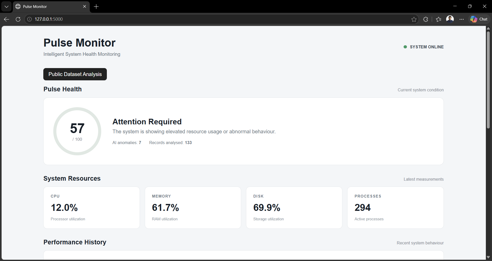
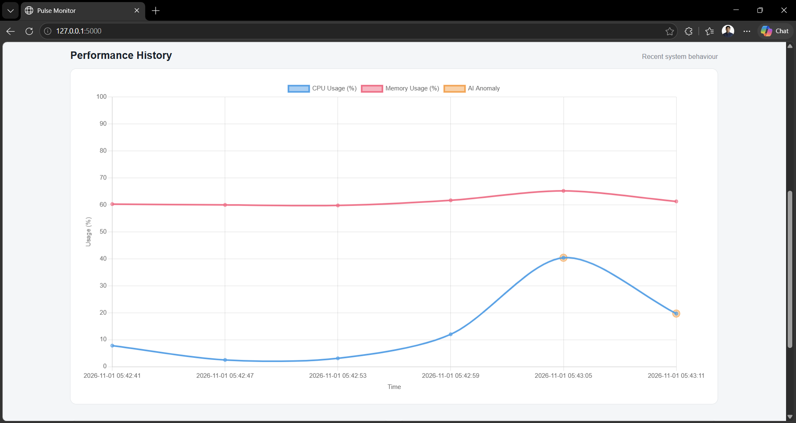
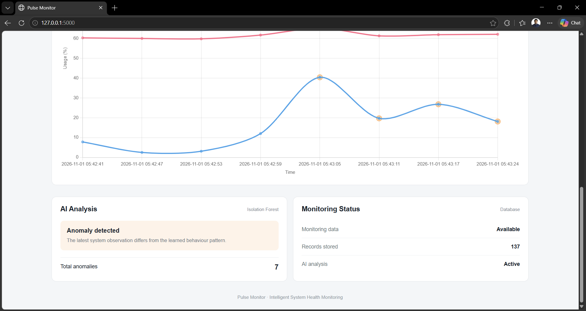
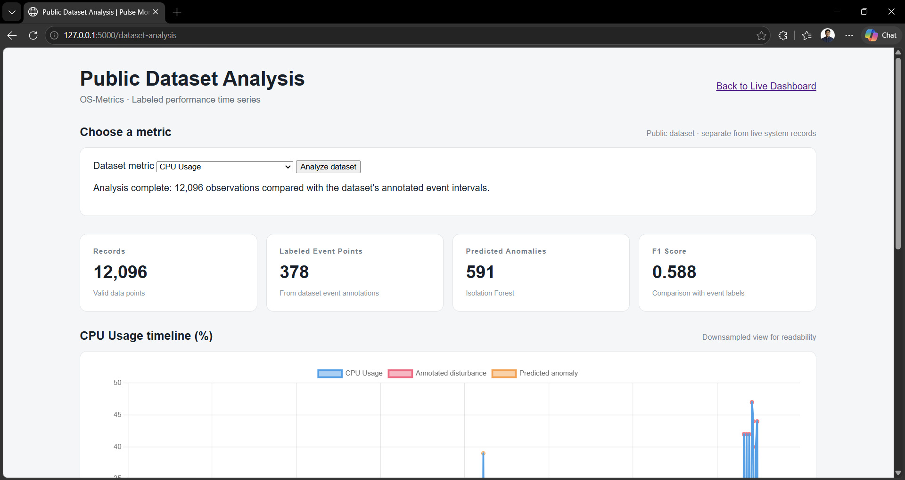
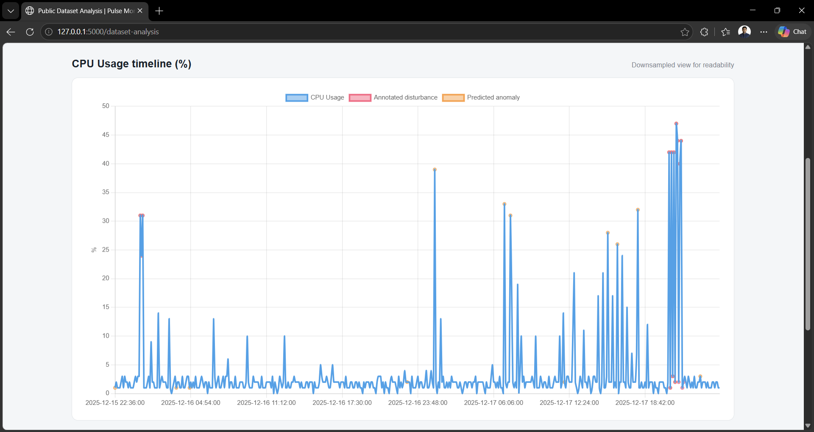
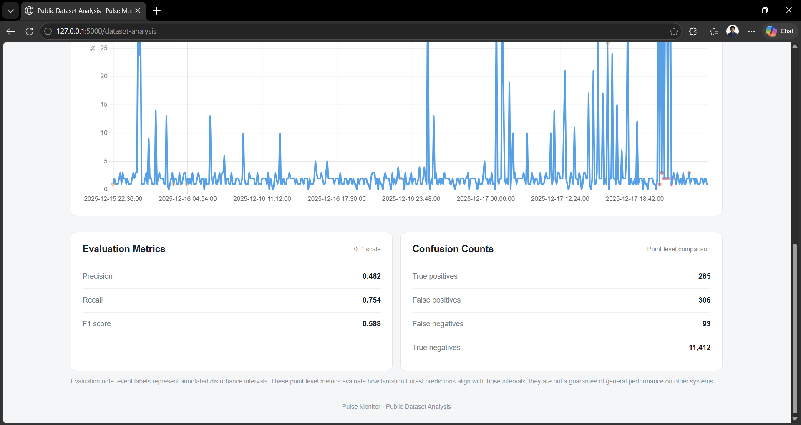
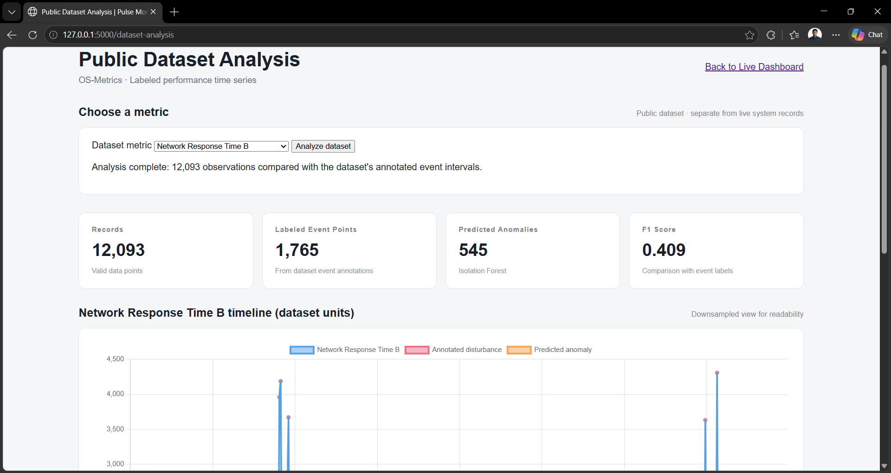
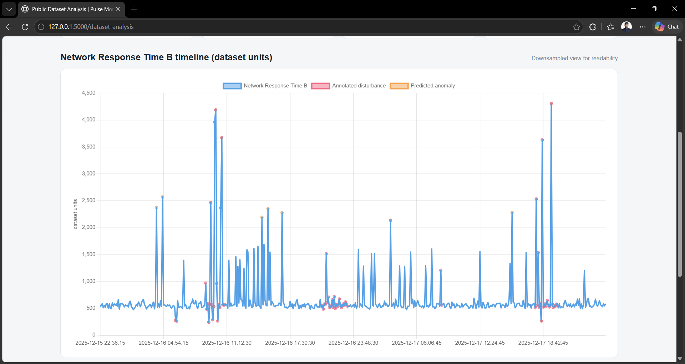
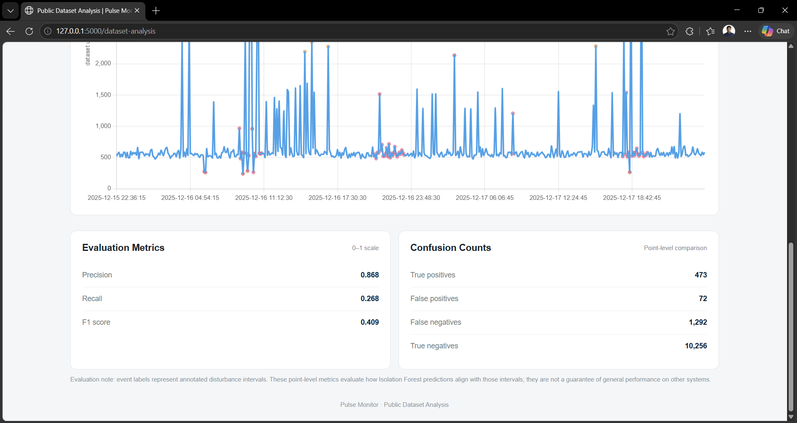

# Pulse Monitor – Intelligent System Health Monitoring Using AI

Pulse Monitor is a Python-based system health monitoring application designed to observe system resource usage, visualize performance metrics, and explore machine-learning-based anomaly detection.

It provides a local web dashboard for monitoring system performance and a separate dataset analysis interface for evaluating system metrics using machine learning techniques.

## Features

- **Live System Monitoring:** Collects CPU, memory, disk, and network-related system metrics.
- **Interactive Dashboard:** Displays system performance information through a web-based interface.
- **System Health Score:** Calculates an overall health score using resource utilization and anomaly status.
- **AI-Based Anomaly Detection:** Uses machine learning techniques to identify unusual system behaviour.
- **Public Dataset Analysis:** Analyses system metrics using a public OS-metrics dataset.
- **SQLite Database:** Stores locally collected monitoring information.
- **Background Data Collection:** Collects system metrics while the web application is running.
- **Local Deployment:** Runs as a local web application on the user's computer.

## Screenshots

### 1. Dashboard Analysis

The dashboard provides a visual overview of system performance and resource utilization.







### 2. Dataset Analysis

The dataset analysis section presents machine-learning evaluation results and visualizations based on the public system metrics dataset.













## Technology Stack

| Technology | Purpose |
|---|---|
| Python | Core application development |
| Flask | Web application and routing |
| Waitress | WSGI server |
| psutil | System resource monitoring |
| NumPy | Numerical computation |
| Pandas | Dataset processing |
| Scikit-learn | Machine learning and anomaly detection |
| SQLite | Local database |
| HTML, CSS, JavaScript | Dashboard interface |

## Project Structure

```text
PulseMonitor/
│
├── app/
│   ├── routes.py
│   ├── templates/
│   └── static/
│
├── collector/
│   ├── system_monitor.py
│   └── collector_service.py
│
├── database/
│   ├── database.py
│   └── queries.py
│
├── models/
│   ├── anomaly_detector.py
│   └── public_dataset_analysis.py
│
├── data/
│   └── public_dataset/
│
├── utils/
│
├── screenshots/
│   ├── dashboard-analysis/
│   └── dataset-analysis/
│
├── main.py
├── requirements.txt
└── README.md
```

*Note: The structure above highlights the main project components. Some supporting files and directories may not be shown.*

## Getting Started

### Prerequisites

- Windows, Linux, or macOS with a compatible Python environment.
- Python and pip installed.
- Git (if cloning the repository).

### 1. Clone the Repository

```bash
git clone https://github.com/DebojyotiMondalDev/PulseMonitor.git
cd PulseMonitor
```

### 2. Create a Virtual Environment

```bash
python -m venv .venv
```

### 3. Activate the Environment

**Windows PowerShell:**

```powershell
.\.venv\Scripts\Activate.ps1
```

**Linux/macOS:**

```bash
source .venv/bin/activate
```

### 4. Install Dependencies

```bash
python -m pip install -r requirements.txt
```

### 5. Run the Application

```bash
python main.py
```

### 6. Open the Dashboard

Open your browser and visit:

- **Main Dashboard:** http://127.0.0.1:5000/
- **Dataset Analysis:** http://127.0.0.1:5000/dataset-analysis

The application runs locally on your computer. Press `Ctrl + C` in the terminal to stop it.

## Public Dataset Analysis

Pulse Monitor includes a public system metrics dataset for exploring machine-learning-based anomaly detection.

The dataset contains six metric files:

- `cpu_usage.csv`
- `memory_usage.csv`
- `memory_used.csv`
- `network_response_time_a.csv`
- `network_response_time_b.csv`
- `network_response_time_diff.csv`

It also includes event-log files associated with CPU, memory, and network metrics.

### Evaluation Approach

The analysis uses:

- Chronological 70/30 training and testing split.
- Precision.
- Recall.
- F1-score.
- Metric-specific performance evaluation.

The chronological split helps preserve the time order of observations instead of randomly mixing earlier and later records.

### Important Considerations

- Memory Usage and Memory Used are highly correlated, so their evaluation results should not be treated as independent evidence.
- Results depend on the dataset, preprocessing, labels, and model configuration.
- Performance on a public dataset does not guarantee the same performance on every real-world computer.

Refer to `data/public_dataset/DATASET_README.txt` for the dataset-specific information available in the repository.

## Local Database

Pulse Monitor stores locally collected monitoring data in an SQLite database.

On Windows, the database is stored under:

```text
%LOCALAPPDATA%\PulseMonitor\pulse_monitor.db
```

The database is created and maintained locally. It is not intended to be distributed as part of the source repository.

## Windows Releases

Pre-packaged Windows builds are available through GitHub Releases.

### Latest Release: v0.1.1

**[Download Pulse Monitor v0.1.1 – Windows](https://github.com/DebojyotiMondalDev/PulseMonitor/releases/download/v0.1.1/PulseMonitor_v0.1.1_Windows.zip)**

**[View Release Notes](https://github.com/DebojyotiMondalDev/PulseMonitor/releases/tag/v0.1.1)**

### What's New in v0.1.1

- Fixed dashboard initialization when fewer than 10 monitoring records are available.
- Added a first-run initialization screen.
- Improved history API handling when insufficient monitoring data is available.
- Preserved the 10-record minimum required for AI anomaly detection.

### Installation

1. Download `PulseMonitor_v0.1.1_Windows.zip`.
2. Extract the complete ZIP archive.
3. Open the extracted `PulseMonitor` folder.
4. Run `PulseMonitor.exe`.
5. Open http://127.0.0.1:5000/ in your browser.

**Important:** Keep the `_internal` directory alongside `PulseMonitor.exe`. Do not move the executable outside the extracted folder.

### Previous Release

- [v0.1.0 – Windows Preview](https://github.com/DebojyotiMondalDev/PulseMonitor/releases/tag/v0.1.0)

### Release Compatibility

- Platform: Windows 10/11 (64-bit).
- A separate Python installation is not required for the packaged build.
- The application runs locally on the host computer.
- The packaged application has been tested in the developer's Windows environment. Compatibility should be evaluated on additional systems.

## Limitations

- The current application is designed for local execution.
- Monitoring results depend on the host computer and its available system metrics.
- Public dataset evaluation may not represent every real-world workload.
- The packaged Windows version requires additional testing across different system configurations.
- Anomaly detection performance depends on data quality and model configuration.
- At least 10 monitoring records are required before AI anomaly detection becomes available.

## Future Improvements

- Enhanced real-time monitoring and visualization.
- Improved anomaly detection models.
- More detailed system performance analytics.
- Additional operating-system support and compatibility testing.
- Improved reporting and export functionality.

## Author

**Debojyoti Mondal**

- GitHub: [DebojyotiMondalDev](https://github.com/DebojyotiMondalDev)
- Project Repository: [Pulse Monitor](https://github.com/DebojyotiMondalDev/PulseMonitor)

---

*Pulse Monitor – Intelligent System Health Monitoring Using AI.*
